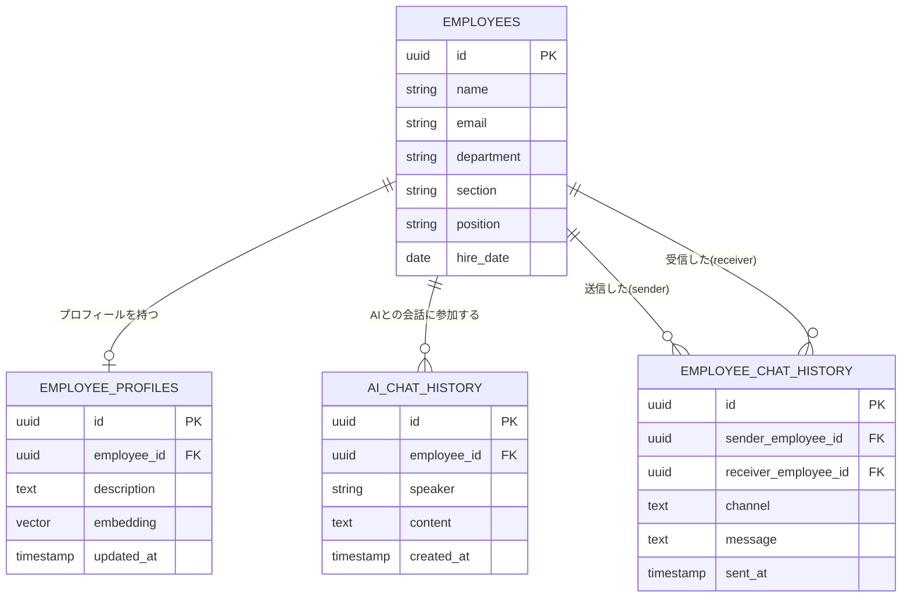
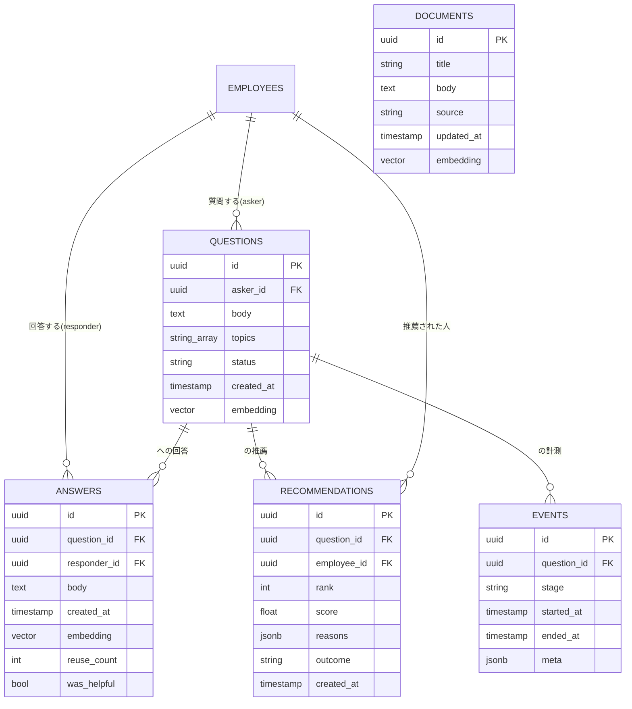
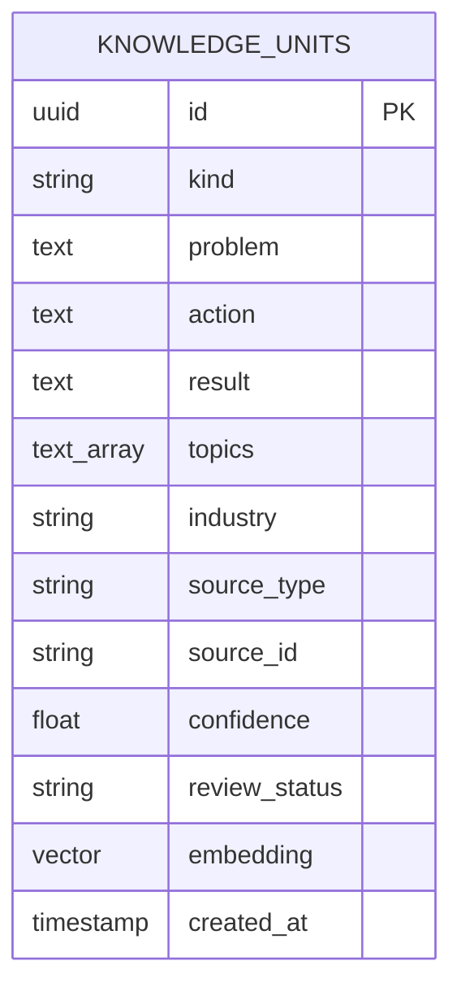

# DBスキーマ（ER図） — TEKIJIN

TEKIJIN のデータベース設計。**4層**で構成する。

- **A. 入力データ層** … 合成データ（PR #19）が埋める、社員・プロフィール・チャット。日報・案件は #97 で表ごと消した（`company-v1` タグに残る）。PR #18 の ER をベースとし、本ドキュメントを正とする。
- **B. アプリ実行時テーブル** … 質問・回答・推薦・計測など、アプリ稼働で溜まるデータ（技術仕様 §4 準拠）。
- **C. 専門性グラフ** … 表としては持たない。`person_topic_edges` と `evidence` は読む側が無かったため #89 で削除した（`company-v1` タグに残る）。
- **D. 形式知層** … 生データから抽出した構造化ケース知識 `knowledge_units`（#357/#448＝蓄積＝主軸）。

他テーブルはすべて `EMPLOYEES` の「誰」を FK で指す。永続化は PostgreSQL 16 + pgvector 1本（LangGraph の checkpoints は PostgresSaver が自動管理し、本図には含めない）。

> 整合状況（2026-08-21 監査）: A層は PR #18 の ER に忠実。**B層・C層は技術仕様 §4 / doc15 が要求するが ER 未登場**のため本ドキュメントで補完した。実データ(PR #19)を A層スキーマへ寄せる方針は #18/#19 のレビューで追跡。
>
> 実装補足（#28）: PK 型は本 ER 図の `uuid` 表記ではなく**フィクスチャ実体に準拠**する。`employees` は `int`、`q_` / `ans_` / `doc_` 接頭辞を持つエンティティ（questions・answers・documents）は `string`。
>
> #97 で `daily_reports`・`projects`・`project_members`・`certifications`・`skills` の表と `employees.branch` 列をコードから消した。マイグレーションの仕組みが無く `DROP TABLE` もしないので、それより前に作った DB にはこれらが残る。コードは読みも書きもせず、seed の `TRUNCATE employees … CASCADE` で中身だけ空になる。

## A. 入力データ層（合成データ層）— ER図

## A層 各テーブルの説明

### EMPLOYEES（社員基本情報）
社員1人につき1行。部・課の両方を記録できる。他のテーブルはすべてこのテーブルの「誰」を指し示す形でつながっている。

| カラム | 説明 |
|---|---|
| `id` | 社員を一意に識別するID |
| `name` / `email` | 氏名・メールアドレス |
| `department` / `section` | 部・課 |
| `position` | 役職 |
| `hire_date` | 入社日 |

### EMPLOYEE_PROFILES（社員プロフィール）
社員1人につき1行。スキル・特徴を自由記述の文章としてまとめて記録する。`embedding` 列を持たせることで、他の検索対象（過去QA、文書など）と同じ仕組みで意味検索にかけられる。

| カラム | 説明 |
|---|---|
| `employee_id` | 誰のプロフィールか（1人1行、UNIQUE） |
| `description` | スキル・得意分野・人柄などをまとめた自由記述文 |
| `embedding` | `description` をベクトル化したもの（AI検索用） |
| `updated_at` | 最終更新日時 |

### AI_CHAT_HISTORY（AIチャット履歴）
1行=1メッセージの会話ログ形式。`speaker` 列で発言者が社員かAIかを区別する。`employee_id` は常に EMPLOYEES への FK で、「どの社員との会話セッションか」を表す（AIが発言したメッセージの行でも、`employee_id` にはその会話相手の社員IDが入る）。

| カラム | 説明 |
|---|---|
| `employee_id` | どの社員の会話セッションか（FK、常に社員を指す） |
| `speaker` | 発言者の区分:「employee」か「ai」（FKではなく単純な区分値） |
| `content` | 発言内容（質問文、またはAIの回答文） |
| `created_at` | 発言日時 |

### EMPLOYEE_CHAT_HISTORY（社員間チャット履歴）
社員同士のチャット（SlackやTeams等から取り込んだ会話ログを想定）。「誰が誰に、何を話したか」を記録する。

| カラム | 説明 |
|---|---|
| `sender_employee_id` | 送信した社員 |
| `receiver_employee_id` | 受信した社員（グループチャットの場合は空でもよい） |
| `channel` | チャンネル名やグループ名（1対1の場合は空でよい） |
| `message` | メッセージ本文 |
| `sent_at` | 送信日時 |

### OFFLINE_CONSULTS（直接相談のふりかえり・#247）

「直接相談」（#245）は対面で行われるためチャットのような発言記録が残らず、F-10（回答を索引に
追加し専門性の推定を更新）が使える材料が無い。この表がその欠けた記録で、**質問者が書く**。

| カラム | 説明 |
|---|---|
| `question_id` | どの質問についての相談か（FK・NOT NULL・**質問ごとに1件（UNIQUE）**）。受諾される取次ぎは質問につき1件なので「その相談」は単数。重ねて書けると1回の実相談で上限（4件）を埋められる |
| `responder_id` | 相談に応じた人。**この行が専門性の証拠になる対象**。リクエスト本文で送るが信用しない——**その質問の取次ぎを受諾した本人**（`recommendations.outcome='accepted'`）と一致することを API が要求する |
| `asker_id` | 書いた人。認証済みプリンシパルから取り、リクエスト本文からは受け取らない |
| `topics[]` | `TOPIC_VOCABULARY` から選択（API 境界で検証）。スコアラーはこの文字列で join する |
| `asked` | 何を聞いたか（任意） |
| `answer_body` | 得られた回答・アドバイス（必須） |
| `resolution` | `resolved` / `partial` / `unresolved` |
| `created_at` | 記録日時（DB 既定 `now()`） |

**伝聞であることを重みに反映する**: 「質問者が、相談相手の発言を要約して書いたもの」なので、
過去の回答（0.7）よりずっと低い **0.25**。件数で `topic_fit` を飽和させないよう上限
（`OFFLINE_CONSULT_EVIDENCE_CAP` = 4）を設ける。

**「誰が書けるか」と「誰について書けるか」は別の制約**: 質問の所有者だけが書ける（前者）と
しても、質問は自分で作れるので、それだけでは任意の社員に上限いっぱいの証拠を付けられる。
後者を締めるのが `responder_id` = 受諾者の照合で、これが実際にスコアを守っている側。
受諾行が唯一の「この人に実際に相談した」という永続記録なので、権限の根拠としても正しい。

**書く時点で読める情報源が要る**: `GET /handoff` は保留中の取次ぎビューで、対応者が結末を
記録した瞬間に 404 する——対面で相談できるようになる、まさにその瞬間に消える。ふりかえり
画面は `GET /consult-retrospective/{session_id}`（`questions` + `recommendations` +
`offline_consults` を直接読む）を使う。

---

## B. アプリ実行時テーブル（技術仕様 §4 準拠）

アプリ稼働で溜まるデータ。質問→推薦→回答→計測のループを支える。合成データではなく、デモ実行中に生成される（一部は評価用に合成でシードする）。

| テーブル | 役割 | 主なカラム |
|---|---|---|
| `QUESTIONS` | 聞く側の質問 | `asker_id` FK, `body`, `topics[]`, `status`, `embedding` |
| `ANSWERS` | 回答（**F-10 ナレッジ化・学習の燃料**） | `question_id` FK, `responder_id` FK, `body`, `embedding`, `reuse_count`, `was_helpful` |
| `RECOMMENDATIONS` | 推薦結果と結末（**学習の要**） | `question_id` FK, `employee_id` FK, `rank`, `score`, `reasons`(jsonb), `outcome`(accepted/declined/timeout), `created_at`(推薦時刻・DB既定 now) |
| `EVENTS` | 各ステージの計測（**p50/p95 レイテンシKPI**） | `question_id` FK, `stage`, `started_at`, `ended_at`, `meta` |
| `DOCUMENTS` | 社内文書（格下げ経路用・優先度低） | `title`, `body`, `source`, `embedding` |
| `OFFLINE_CONSULTS` | **直接相談のふりかえり**（#247。対面相談は記録が残らないため、質問者が書き起こす。伝聞なので base_score 0.25 = 過去の回答 0.7 よりずっと低い） | `question_id` FK, `responder_id` FK, `asker_id` FK, `topics[]`, `asked`, `answer_body`, `resolution`(resolved/partial/unresolved), `created_at` |

> `ANSWERS.reuse_count`/`was_helpful` は `answer_quality` スコアと C8 グラフ更新に、`RECOMMENDATIONS.outcome` は `load`（負荷）減点と「使うほど育つ」学習に、`EVENTS` はレイテンシ計測に直結する（技術仕様 §5・§7）。`RECOMMENDATIONS.created_at`（DB 既定 `now()`）は `load` を**直近7日**の推薦数で数えるための時刻窓に使う（技術仕様 §5）。実装では `ANSWERS.created_at` も同様に DB 既定 `now()` を持ち、実行時に生成される回答へ確実に時刻が入る。

---

## C. 専門性グラフ（doc15＝新規性の中核）

「誰が何に詳しいか」は、行動痕跡（過去の回答・直接相談のふりかえり）から C6 スコアラーがその場で積み上げて求める（`scorer/evidence.py`）。資格・スキル・案件は #95 で根拠から外し、#97 で表も消した。以前は人×トピックのエッジを `PERSON_TOPIC_EDGES`、その根拠を `EVIDENCE` という表に置く設計だったが、どちらも読む側が無かったため #89 で削除した。設計と定義は `company-v1` タグに残っている。

> `base_score`: 有用回答 1.0 > 過去回答 0.7（doc15）> **直接相談のふりかえり 0.25**（#247・伝聞）。断り(declined)は専門性を下げず余裕度のみ下げる。
>
> **同じ規則をふりかえりにも適用する**: `resolution=unresolved`（解決しなかった）は記録は残るが
> 専門性の証拠にならず、**下げもしない**。一度うまくいかなかったことが、その人が実際に知っている
> トピックでの評価を損なってはいけない。

---

## D. 形式知層（#357/#448＝蓄積＝主軸の実体）

生データ（社員間チャット・解決済スレッド）から LLM で蒸留した**構造化ケース知識**。graph からは呼ばない
オフライン抽出バッチ（`knowledge/chat.py` チャット）と解決済スレッドの取り込み（`knowledge/slack_thread.py`）が upsert し、
埋め込み索引を張れば C4／自己回答（System1）が再利用する。承認（`review_status`）まで検索経路に出さない（#354）。

| カラム | 説明 |
|---|---|
| `kind` | `case`（問題→打ち手→結果）/ `procedure` / `decision`（CHECK 制約） |
| `problem` / `action` / `result` | ケースの中身（`result` は未確定なら NULL） |
| `topics` | 正規22語彙のトピック（解決済スレッドは質問のタグ継承、チャットは LLM 提案を `normalize_topics` でスナップ） |
| `industry` | 業種（明示があるときのみ） |
| `source_type` / `source_id` | 出典（`chat`/`slack_thread` 等）。**`UNIQUE(source_type, source_id)`** で冪等 upsert |
| `confidence` | 抽出の確信度（0.0–1.0） |
| `review_status` | `unreviewed` / `approved` / `rejected`（CHECK）。既定は検索で `approved` のみ露出 |
| `embedding` | ケーステキスト（problem+action+result）の dense ベクトル。索引後に検索で再利用 |

> **索引**: `GIN(topics)`。**measure-first の結果（#448）**: 合成チャットは抽出0件（ケース不在＝データの限界・手法は正）、
> 日報は 25/30 抽出（陽性対照）。実データ（解決済スレッド）で価値が出る。

---

## A層の補足（仕様整合のための追加が必要な列）

PR #18 の ER（A層）に、仕様上あと少し不足がある。実データ(PR #19)を寄せる際に合わせて補う。

| 対象 | 追加/変更 | 理由 |
|---|---|---|
| `EMPLOYEES` | ~~`branch`(拠点)~~ **#97 で削除** | もとは `proximity`（同支店>同エリア>全社）の計算に使った。#93 で `proximity` を消し、#97 で列も消した |
| `EMPLOYEES` | ~~`role` を追加~~ **実装済**（`department_history` / `password_hash` も追加済） | 職種比率・スコアの説明に使用 |
| （算出でよい） | `years`(在籍年数) は `hire_date` から算出 | 冗長カラムにしない |
